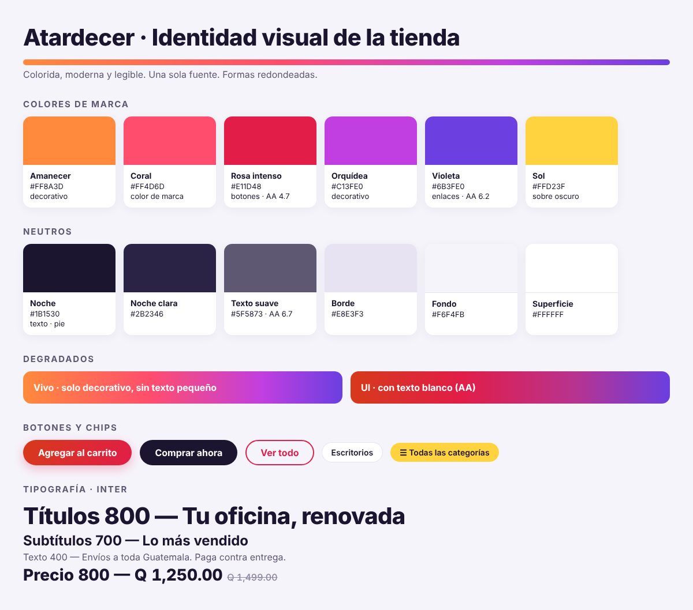

# Manual de marca — Identidad "Atardecer"

> Fuente de verdad visual de la tienda. Los valores en código viven en
> `website_solucloud_market/static/src/scss/market_tokens.scss`:
> **si cambias un color aquí, cámbialo allá (y viceversa).**

## 1. Personalidad
- **Colorida y alegre**, sin parecer infantil: el degradado se usa en franjas y
  fondos; el contenido (productos, precios) va sobre blanco.
- **Moderna**: formas redondeadas, botones tipo píldora, sombras suaves.
- **Clara para comprar**: un solo color manda la acción (rosa intenso), el precio
  se lee primero y nada compite con la foto del producto.
- **Rápida**: una sola fuente, sin librerías de carrusel extra (se usan los
  bloques nativos de Odoo).

## 2. Colores

### 2.1 Marca
| Nombre | HEX | Uso | Texto blanco encima |
|---|---|---|---|
| Amanecer | `#FF8A3D` | Inicio del degradado vivo | ❌ 2.35 (solo decorativo) |
| Coral | `#FF4D6D` | Color de marca, foco, detalles | ⚠️ 3.21 (solo títulos grandes) |
| **Rosa intenso** | `#E11D48` | **Botones de compra**, ofertas, paginación | ✅ 4.70 |
| Brasa | `#D63A1A` | Inicio del degradado con texto | ✅ 4.69 |
| Ciruela | `#B8338F` | Centro del degradado con texto | ✅ 5.37 |
| Orquídea | `#C13FE0` | Centro del degradado vivo | ⚠️ 4.15 (solo decorativo) |
| Violeta | `#6B3FE0` | Enlaces, final de degradados | ✅ 6.15 |
| Sol | `#FFD23F` | Detalles sobre fondo oscuro, hover | (usar texto Noche: ✅ 12.15) |

### 2.2 Neutros
| Nombre | HEX | Uso |
|---|---|---|
| Noche | `#1B1530` | Texto principal, barra superior, pie (✅ 17.5 sobre blanco) |
| Noche clara | `#2B2346` | Hover sobre oscuro, círculos de redes |
| Texto suave | `#5F5873` | Texto secundario (✅ 6.7) |
| Texto tenue | `#8D87A0` | Precio anterior tachado, placeholders (solo texto no esencial) |
| Borde | `#E8E3F3` | Bordes de tarjetas y campos |
| Fondo | `#F6F4FB` | Fondo de página |
| Superficie | `#FFFFFF` | Tarjetas, encabezado |

### 2.3 Estados
| Estado | HEX |
|---|---|
| Éxito / en existencia | `#12805C` |
| Advertencia / pocas unidades | `#B26A00` |
| Error | `#D92F52` |

### 2.4 Degradados
| Nombre | Valor | Regla |
|---|---|---|
| **Vivo** | `linear-gradient(90deg, #FF8A3D 0%, #FF4D6D 40%, #C13FE0 75%, #6B3FE0 100%)` | Franjas, fondos de banner con texto **grande y grueso**, bordes. Nunca texto pequeño encima. |
| **UI** | `linear-gradient(90deg, #D63A1A 0%, #E11D48 35%, #B8338F 70%, #6B3FE0 100%)` | Barras con texto blanco normal (barra de categorías). |
| **Compra** | `linear-gradient(120deg, #D63A1A 0%, #E11D48 100%)` | Botones de compra, buscador, carrito. |

## 3. Tipografía
- **Familia única: Inter** (Google Fonts, pesos 400 · 500 · 600 · 700 · 800).
  Respaldo: `system-ui, -apple-system, "Segoe UI", Roboto, sans-serif`.
- Por velocidad **no se agregan más fuentes**.

| Elemento | Tamaño | Peso | Notas |
|---|---|---|---|
| Título de banner | 40–56 px | 800 | interletrado −0.02em |
| H1 (página) | 28–32 px | 800 | |
| H2/H3 (secciones: "Lo más vendido") | 22–26 px | 700 | |
| Texto | 15–16 px | 400 | color Noche o Texto suave |
| Nombre de producto (tarjeta) | 14–15 px | 500 | máximo 2 líneas |
| **Precio** | 18 px (tarjeta) · 32 px (ficha) | 800 | `tabular-nums` para alinear cifras |
| Precio anterior | 13 px | 500 | tachado, Texto tenue |
| Etiqueta de oferta | 11–12 px | 800 | MAYÚSCULAS |
| Botones | 15–16 px | 700 | |

## 4. Formas y sombras
| Elemento | Radio |
|---|---|
| Tarjetas, banners | 16 px |
| Cajas, filtros | 12 px |
| Campos | 8 px |
| Botones, buscador, chips, paginación | píldora (999 px) |
| Categorías | círculo de 76 px (60 px en celular) |

- Sombra normal: `0 1px 2px rgba(27,21,48,.05), 0 4px 16px rgba(27,21,48,.06)`
- Sombra al pasar el mouse: `0 10px 30px rgba(27,21,48,.14)` y la tarjeta sube 3 px.

## 5. Logo
- Siempre sobre **blanco**: encabezado, placa blanca o fondo claro.
- Alto: **64 px** en escritorio, **44 px** en celular (lo controla el CSS).
- Formato recomendado: **SVG**, o PNG con fondo transparente de al menos 400 px de ancho.
- No poner el logo directamente sobre el degradado.

## 6. Imágenes

### 6.1 Banners (bloque "Carrusel")
| Pieza | Tamaño | Peso máximo | Formato |
|---|---|---|---|
| Banner principal (escritorio) | **1600 × 600 px** | 250 KB | WebP (o JPG 80 %) |
| Banner lateral | 800 × 600 px | 120 KB | WebP |
| Banner de sección (ancho completo) | 1600 × 400 px | 200 KB | WebP |

- Zona segura: deja libre el **15 % de cada lado** (ahí van las flechas).
- Texto del banner: título 800, máximo **6 palabras**, más un botón.
- Para banners hechos solo con color, usa el degradado **Vivo** de fondo y texto blanco **grande**.

### 6.2 Productos
- Fondo **blanco**, cuadradas: **1000 × 1000 px** como mínimo, WebP/JPG de menos de 150 KB.
- El producto debe ocupar alrededor del 80 % del cuadro, centrado.

### 6.3 Categorías (círculos)
- Imagen cuadrada de **256 × 256 px**, con el producto recortado sobre fondo transparente o blanco.
- Se carga en *Sitio web → eCommerce → Categorías → (categoría) → Imagen*.

## 7. Voz y tono
- Tutear al cliente ("Agrega", "Tu carrito"), frases cortas y en positivo.
- Precios siempre con **Q** y dos decimales: `Q 1,250.00`.
- Llamadas a la acción: **Agregar al carrito** · **Comprar ahora** · **Ver todo**.

## 8. Paleta para el editor de Odoo
*Sitio web → Editar → Tema → Colores*:

| Color de Odoo | HEX |
|---|---|
| Color 1 (primario) | `#E11D48` |
| Color 2 (secundario) | `#6B3FE0` |
| Color 3 (claro) | `#F6F4FB` |
| Color 4 (blanco) | `#FFFFFF` |
| Color 5 (oscuro) | `#1B1530` |
